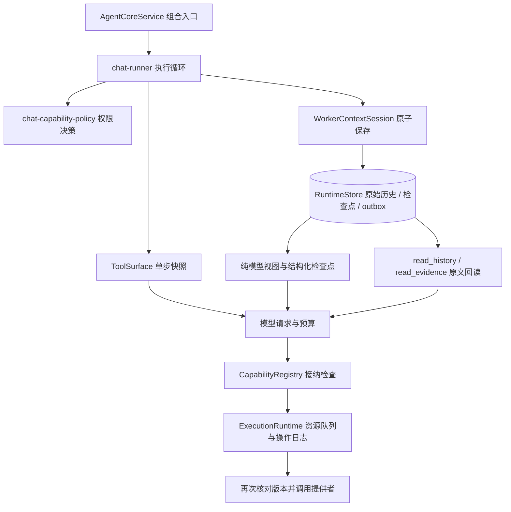

# Agent 运行架构与优化

本次对照 DeepSeek 的两个官方开源项目，将工具授权、单步工具定义和模型历史视图从执行循环中分离。目标是减少长工具结果反复进入模型的开销，并使插件更新、取消及 Worker 恢复时的执行行为可验证。

## 参考与采用范围

参考固定到以下提交，便于后续复核：

| 参考 | 采用的原则 | MyPlaneAgent 的实现 |
| --- | --- | --- |
| [DeepSeek Harness 架构](https://github.com/deepseek-ai/deepseek-harness/blob/ce7073d51254c26cd63b22a60835b8f948deb447/docs/architecture.md) | 步骤接纳的工具定义与正在变化的服务分离；原始记录与模型视图分离 | `tool-surface.ts`、Registry 接纳版本、`model-context-projection.ts` |
| [Harness 工具管线](https://github.com/deepseek-ai/deepseek-harness/blob/ce7073d51254c26cd63b22a60835b8f948deb447/packages/core/tools/src/pipeline.ts) | 在执行边界固定定义并检查有效性 | 模型调用前固定 Schema、权限和版本；资源排队结束后再次检查提供者 |
| [DeepSeek Super Agent 架构](https://github.com/deepseek-ai/dsh-superagent-prototype/blob/6337fc823ce20251c8de8085948165c81aaa701e/docs/007-architecture.md) | 组合入口、领域状态与副作用适配层分工；持久化后再交付事件 | 沿用 AgentCoreService 组合入口、Worker 原子保存与 outbox；将权限决策和上下文投影移出聊天循环 |

本次采用这些边界原则，没有引入 Cordis，也没有替换为 Super Agent 的完整 Engine。模型工具调用仍按现有顺序执行；已有的两个只读 Worker 并行规则保持由调度器管理。

## 模块边界

- `chat-capability-policy.ts`：统一可见工具筛选、任务范围、外部路径和审批要求；保留原导出供兼容调用使用。
- `tool-surface.ts`：稳定别名、深冻结定义、Schema 和接纳记录；模型不能自行填写接纳版本。
- `capability-registry.ts`：管理注册版本并路由提供者；同名重新注册也会使旧接纳失效。
- `model-context-projection.ts`：只生成派生输入，不修改原始历史、检查点哈希或执行证据。
- `readback-budget.ts`：依据包含 JSON 转义和工具结果信封的预计 Tokens，裁定分页长度并返回正确游标。
- `worker-context.ts` / `runtime-store.ts`：保存 Worker 历史、检查点、待处理调用和交付事件；恢复时不自动重放未知副作用。

## 每步工具接纳

工具别名由能力名和哈希生成，注册顺序、工具筛选和进程重启不会改变别名。历史中的旧序号别名只在模型视图中通过配对的宿主结果映射，原始记录保持原样；无法确定身份的调用不会猜测改名。

每个模型步骤持有工具定义及接纳版本快照。Registry 在执行入口及资源排队结束后核对注册版本、定义指纹和可用性；内置处理器调用前还会再次检查。若模型等待期间或排队期间同名提供者被替换，旧请求会得到明确的“未执行”结果，不会调用替代提供者，也不会把该拒绝当成未知副作用。

下一步仅在本轮已选择的能力名中更新或撤销定义，重新应用权限策略和预算。新定义需要审批时会按新定义审批。提示中的浏览器和联网工具列表随当前快照刷新。底层 Python 进程或 MCP 连接的内部重连仍由各自适配器负责，Registry 版本并不等于所有外部运行时的代码版本。

## 原始记录与模型视图

宿主结构化工具结果超过单条预算时，模型收到确定性的首尾摘录，保留 `activityId`、能力名、状态与明确的省略说明。单条预算为容量的 12%，最少 256、最多 2048 预计 Tokens，并计入 JSON 转义和元数据。摘录不需要额外模型调用；容量检查与实际请求使用同一视图。

原始结果、参数和历史不变，仍可通过历史或证据接口回读。`runtime.read_history`、`runtime.read_evidence` 的分页结果不再做首尾截取，避免丢失分页中段。已授权且可用的两个回读接口在工具筛选后保留，Schema 仍计入完整请求预算；纯对话等禁用工具的模式不会因此获得工具。

回读处理器根据宿主传入的单条预算缩小页长，返回真实 `nextOffset`，不会按截取前的长度跳过内容。分页不拆开 Unicode 代理对，预算不足以容纳元数据或一个字符时明确失败。历史翻页继续要求 `through` 和 `snapshot`；证据回读时可省略巨大操作参数，并标注 `argsOmitted` 及历史回读入口，持久化参数不受影响。

原始用户要求、当前权限、验收条件和未确认副作用即使尚未生成检查点，也会进入必保留状态。摘要与摘录都不能扩大权限或证明任务通过。若必保留输入和工具 Schema 本身过大，仍由统一容量检查报告限制。

## 验证与边界

自动测试覆盖稳定别名、Schema 深冻结、同名提供者替换、资源排队时更新、可用性回调中的更新、MCP 无变化刷新、重新审批，以及首尾投影、转义与 Unicode、旧别名兼容、原文哈希不变、SQLite 重启后回读和预算分页全文还原。

排队后确认未调用提供者的拒绝仍保留审计证据，但不递增工作目录版本、不占用副作用重放保护；重启后，新接纳且重新授权的请求可以执行。工具正文返回同名字段不能冒充宿主的“未执行”标志。浏览器自动截图和截图 OCR 的宿主调用也携带接纳版本。

本轮验证执行 `npm test`、`npm run check`、`npm run build:renderer` 和 `git diff --check`。固定的长结果样例在 8192 容量下，单条宿主信封的预计输入由 13,850 降至 983 Tokens，额外模型请求为零；这是本地估算的输入体积，不是服务端耗时或全任务 Token 收益。

上下文阶段测试继续覆盖多轮压缩、错误摘要、取消、检查点恢复和未知写入不重放。`scripts/validate-context-live.mjs` 提供真实模型验收入口；真实调用耗时和 Token 收益取决于模型与任务，不用确定性测试结果推断服务端速度。首尾摘录可能省略任务所需的中段，模型必须通过证据编号回读再作结论。
