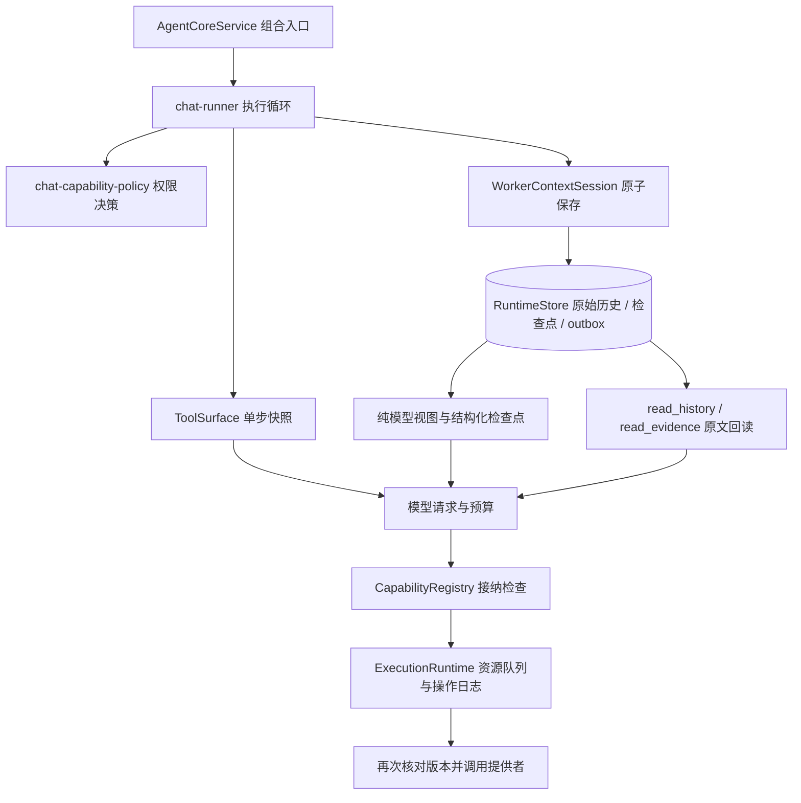

# Agent 运行架构与优化

本次对照 DeepSeek 的两个官方开源项目，将工具授权、单步工具定义和模型历史视图从执行循环中分离。目标是减少长工具结果反复进入模型的开销，并使插件更新、取消及 Worker 恢复时的执行行为可验证。

## 参考与采用范围

参考固定到以下提交，便于后续复核：

| 参考 | 采用的原则 | MyPlaneAgent 的实现 |
| --- | --- | --- |
| [DeepSeek Harness 架构](https://github.com/deepseek-ai/deepseek-harness/blob/ce7073d51254c26cd63b22a60835b8f948deb447/docs/architecture.md) | 步骤接纳的工具定义与正在变化的服务分离；原始记录与模型视图分离 | `tool-surface.ts`、Registry 接纳版本、`model-context-projection.ts` |
| [Harness 工具管线](https://github.com/deepseek-ai/deepseek-harness/blob/ce7073d51254c26cd63b22a60835b8f948deb447/packages/core/tools/src/pipeline.ts) | 在执行边界固定定义并检查有效性 | 模型调用前固定 Schema、权限和版本；资源排队结束后再次检查提供者 |
| [DeepSeek Super Agent 架构](https://github.com/deepseek-ai/dsh-superagent-prototype/blob/6337fc823ce20251c8de8085948165c81aaa701e/docs/007-architecture.md) | 组合入口、领域状态与副作用适配层分工；持久化后再交付事件 | 沿用 AgentCoreService 组合入口、Worker 原子保存与 outbox；将权限决策和上下文投影移出聊天循环 |

本次采用这些边界原则，没有引入 Cordis，也没有替换为 Super Agent 的完整 Engine。模型工具调用仍按现有顺序执行；已有的两个只读 Worker 并行规则保持由调度器管理。

## 模块边界



- `chat-capability-policy.ts`：统一可见工具筛选、任务范围、外部路径和审批要求；保留原导出供兼容调用使用。
- `tool-surface.ts`：稳定别名、深冻结定义、Schema 和接纳记录；模型不能自行填写接纳版本。
- `capability-registry.ts`：管理注册版本并路由提供者；同名重新注册也会使旧接纳失效。
- `model-context-projection.ts`：只生成派生输入，不修改原始历史、检查点哈希或执行证据。
- `readback-budget.ts`：依据包含 JSON 转义和工具结果信封的预计 Tokens，裁定分页长度并返回正确游标。
- `worker-context.ts` / `runtime-store.ts`：保存 Worker 历史、检查点、待处理调用和交付事件；恢复时不自动重放未知副作用。

## 每步工具接纳

工具别名由能力名和哈希生成，注册顺序、工具筛选和进程重启不会改变别名。历史中的旧序号别名只在模型视图中通过配对的宿主结果映射，原始记录保持原样；无法确定身份的调用不会猜测改名。

每个模型步骤持有工具定义及接纳版本快照。Registry 在执行入口及资源排队结束后核对注册版本、定义指纹和可用性；内置处理器调用前还会再次检查。若模型等待期间或排队期间同名提供者被替换，旧请求会得到明确的“未执行”结果，不会调用替代提供者，也不会把该拒绝当成未知副作用。

下一步仅在本轮已选择的能力名中更新或撤销定义，重新应用权限策略和预算。新定义需要审批时会按新定义审批。提示中的浏览器和联网工具列表随当前快照刷新。底层 Python 进程或 MCP 连接的内部重连仍由各自适配器负责，Registry 版本并不等于所有外部运行时的代码版本。

真实模型可能把接纳拒绝当成最终失败。宿主明确区分 `notApplied` 与用户拒绝、未知副作用；当前定义仍可用且其后没有取得新的成功工具结果时，最多给出一次继续执行的纠正提示。它不执行旧参数、不跳过审批，也不在权限收回或已有替代读取取得进展后强制重试。

## 原始记录与模型视图

宿主结构化工具结果超过单条预算时，模型收到确定性的首尾摘录，保留 `activityId`、能力名、状态与明确的省略说明。普通摘录预算为容量的 6%，最少 256、最多 2048 预计 Tokens，并计入 JSON 转义和元数据。连续回读页仍使用容量的 12%（同样限制在 256～2048），为完整元数据与连续原文保留空间。摘录不需要额外模型调用；容量检查与实际请求使用同一视图。

原始结果、参数和历史不变，仍可通过历史或证据接口回读。`runtime.read_history`、`runtime.read_evidence` 的分页结果不再做首尾截取，避免丢失分页中段。已授权且可用的两个回读接口在工具筛选后保留，Schema 仍计入完整请求预算；纯对话等禁用工具的模式不会因此获得工具。

回读处理器根据宿主传入的单条预算缩小页长，返回真实 `nextOffset`，不会按截取前的长度跳过内容。分页不拆开 Unicode 代理对，预算不足以容纳元数据或一个字符时明确失败。历史翻页继续要求 `through` 和 `snapshot`；证据回读时可省略巨大操作参数，并标注 `argsOmitted` 及历史回读入口，持久化参数不受影响。

原始用户要求、当前权限、验收条件和未确认副作用即使尚未生成检查点，也会进入必保留状态。摘要与摘录都不能扩大权限或证明任务通过。若必保留输入和工具 Schema 本身过大，仍由统一容量检查报告限制。

当本次可归档历史已经使用工具摘录、当前请求仍符合硬容量，且预计最多只能节省不足容量 15%（最少 256 Tokens）的输入时，跳过主动模型摘要，避免反复读取完整来源生成只节省少量输入的摘要。手动强制压缩和硬容量检查不受此收益门槛影响；摘要仍读取原始来源。

若可归档前缀中的工具调用与宿主结果完整配对、没有多模态解释或长篇独立分析，也没有正在拼接的历史/证据分页，则自动压缩可以生成 `source=ledger` 的 V2 检查点。台账直接统计宿主记录的返回状态，助手的调用说明只视为计划，短篇独立说明以不可信原文保留；用户目标仍由必保留状态提供。这样不会让摘要模型把“要求读取八批”推断成“八批已经完成”，也不消耗摘要请求。台账仍使用原始历史与状态哈希，执行摘录和原文检索规则不变。旧的模型、恢复检查点继续可读；不符合条件或手动强制压缩时保留原有模型摘要路径。

进程中断后补齐工具消息时，尚未执行的调用没有 `activityId`，恢复层会生成 `outcome=not-applied` 的宿主记录。台账单独统计这些调用，不把调用计划数当成已返回数。例如一次提出八个读取、实际执行四个后中断，恢复后的台账仍只记录四个实际返回和四个未执行。

## 验证与边界

自动测试覆盖稳定别名、Schema 深冻结、同名提供者替换、资源排队时更新、可用性回调中的更新、MCP 无变化刷新、重新审批，以及首尾投影、转义与 Unicode、旧别名兼容、原文哈希不变、SQLite 重启后回读和预算分页全文还原。

排队后确认未调用提供者的拒绝仍保留审计证据，但不递增工作目录版本、不占用副作用重放保护；重启后，新接纳且重新授权的请求可以执行。工具正文返回同名字段不能冒充宿主的“未执行”标志。浏览器自动截图和截图 OCR 的宿主调用也携带接纳版本。

架构落地时执行了 `npm test`、`npm run check`、`npm run build:renderer` 和 `git diff --check`。早期固定长结果样例在 8192 容量下，单条宿主信封的预计输入由 13,850 降至 983 Tokens；真实模型复核后，普通摘录的上限进一步降至 491 Tokens，连续回读保留 983 Tokens。输入缩小不等于完整任务耗时或 Token 必然下降。

上下文阶段测试继续覆盖多轮压缩、错误摘要、取消、检查点恢复和未知写入不重放。`scripts/validate-context-live.mjs` 提供真实模型验收入口；真实调用耗时和 Token 收益取决于模型与任务，不用确定性测试结果推断服务端速度。首尾摘录可能省略任务所需的中段，模型必须通过证据编号回读再作结论。

## 真实模型对照入口

先编译 Electron，通过 `MYPLANE_LIVE_ENDPOINT`、`MYPLANE_LIVE_MODEL` 和 `MYPLANE_LIVE_API_KEY` 指向已加载模型，然后运行：

```bash
node scripts/validate-context-comparison.mjs
node scripts/validate-tool-lifecycle-live.mjs
```

对照脚本在独立目录复制编译产物，仅在基线副本中禁用工具结果摘录，保留稳定别名、预算、权限和恢复逻辑。两组使用同一份批次文件和精确凭据，经过不同子进程中断、恢复和历史分页；记录编译产物哈希。可通过 `MYPLANE_COMPARISON_FIXTURES` 指向已有验收目录复用输入，通过 `MYPLANE_COMPARISON_OUTPUT` 指定全新输出目录。它不修改应用配置或源码，不启动模型，也不提交代码。基线失败仍继续收集优化组结果，任何失败保留在报告中。

报告将长任务和历史检索分开统计，再按逻辑请求合并流式累计用量，计入摘要、重试和完成检查。没有用量报告的请求保持未知，空检查集不能通过验收。模型预热探针不计入任务指标。输出包含合成任务轨迹和模型报告的用量，不保存 API Key。顺序为基线后优化组，单次配对只能说明该次任务表现，不能据此推断稳定的服务端加速。

生命周期脚本另外验证模型等待期间更换提供者、资源排队期间更换提供者，以及真实调用取消后重启恢复。提供者替换后必须按新 Schema 生成参数、触发新审批；旧提供者不得执行。权限策略仍可收回工具，重新审批测试使用当前权限允许、但显式要求审批的只读提供者。

### 2026-11-02 本机实测

使用已安装的 `Qwen3.5-9B-Q4_K_M.gguf`，请求预算 8192、单并发运行时容量 16384。下面列出全部探索轮次的长任务结果；Token 为服务报告的输入与输出总量，包括中断前、恢复、摘要和完成检查。每轮两组复用相同的八个文件；后续轮次继续复用首轮凭据。

| 轮次 / 配置 | 长任务完成 | 请求数 | 总 Tokens | 摘要模型请求 | 压缩次数 |
| --- | --- | ---: | ---: | ---: | ---: |
| 首轮对照：关闭投影 | 是 | 11 | 36,194 | 6 | 3 |
| 首轮普通投影 | 是 | 20 | 58,431 | 9 | 7 |
| 缩小摘录后的对照 | 是 | 16 | 46,163 | 8 | 6 |
| 缩小摘录 / 收益门槛 | 否 | 24 | 69,368 | 10 | 8 |
| 加入台账、尚未识别恢复占位的对照 | 否 | 26 | 74,788 | 12 | 10 |
| 加入台账、尚未识别恢复占位 | 否 | 16 | 50,962 | 7 | 4 |
| 最终轮对照 | 否 | 12 | 39,465 | 6 | 3 |
| 最终台账与恢复修复 | 是 | 9 | 27,281 | 1 | 5 |
| 最终版本独立复测 | 是 | 9 | 27,116 | 1 | 5 |

最初的文本缩减确实出现了完整任务成本回退；中间轮次还暴露了模型虚构进度和把未执行的批量计划当作完成记录的问题。修复后两次独立运行均取得全部八个完整凭据、只写入一次、没有批次重复读取，并在新进程恢复时保持历史哈希和 generation 一致。五次长任务压缩中四次为不调用模型的宿主台账，一次为候选回答产生后的普通摘要。

两次最终运行的历史检索都完成了十二页原文回读，分别消耗 19 请求 / 52,297 Tokens 和 19 请求 / 52,774 Tokens。复测另用 1 请求 / 2,042 Tokens 注入错误摘要，取得八个正确完整值且没有调用文件工具。三项生命周期场景均通过：模型等待期间替换、资源排队期间替换、真实取消后恢复。

最终轮对照组仍受阻，所以该轮配对总报告如实标记未全部通过；优化组自身及独立复测的验收全部通过。不同轮次的模型轨迹也有变化，不能以这些单次耗时或不同完成度的成本宣称稳定加速。全部中间失败、原始请求和响应保存在隔离输出目录。本地聚合索引为忽略提交的 `tests/artifacts/live-context-validation-2026-11-02/summary.json`，其中列出完整报告位置。常规验证为 811 项测试（807 通过、4 项原有跳过），类型检查通过。
